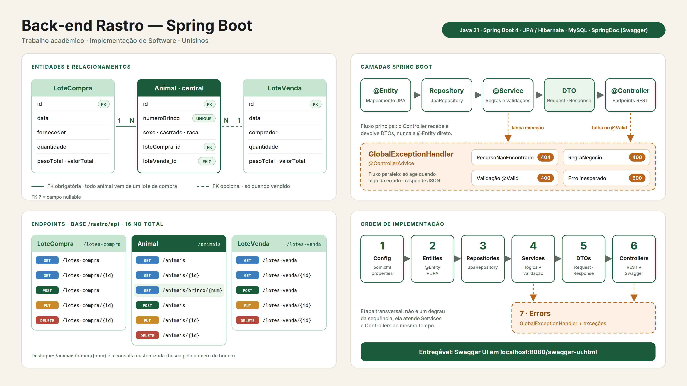

# 🐂 Rastro API


API REST para gestão de pecuária de corte, desenvolvida com Spring Boot. Controla o ciclo de vida do gado, da **compra** à **venda**, passando pelo cadastro e identificação de cada **animal** pelo número do brinco.

> Trabalho acadêmico da disciplina **Implementação de Software** - Unisinos.

---

## 📌 Sobre o Rastro

O **Rastro** é um sistema de gestão de pecuária de corte com rastreamento dos animais. Esta API é o núcleo de dados do sistema: registra os lotes comprados, os animais que entram na propriedade e os lotes vendidos, mantendo a rastreabilidade de cada animal do início ao fim do ciclo.

---

## 🗺️ Visão geral



---

## 🧩 Modelo de dados

| Entidade | Campos | Relacionamento |
|---|---|---|
| **LoteCompra** | `id`, `data`, `fornecedor`, `quantidade`, `pesoTotal`, `valorTotal` | 1 lote → N animais |
| **Animal** *(central)* | `id`, `numeroBrinco` (único), `sexo`, `castrado`, `raca`, `loteCompra`, `loteVenda` | pertence a 1 lote de compra (obrigatório) e a 1 lote de venda (opcional) |
| **LoteVenda** | `id`, `data`, `comprador`, `quantidade`, `pesoTotal`, `valorTotal` | 1 lote → N animais |

Todo animal entra na propriedade por um lote de compra. O vínculo com o lote de venda só é preenchido quando o animal é vendido.

---

## 🏗️ Arquitetura

Organizada em camadas, cada uma com uma responsabilidade:

| Camada | Responsabilidade |
|---|---|
| `entity` | Mapeamento das tabelas com JPA/Hibernate |
| `repository` | Acesso ao banco via `JpaRepository` |
| `service` | Regras de negócio e validações |
| `dto` | Objetos de entrada (`RequestDTO`) e saída (`ResponseDTO`) |
| `controller` | Endpoints REST: recebe e devolve DTOs, nunca a entidade diretamente |
| `exception` | Tratamento centralizado de erros com `@ControllerAdvice` |

O tratamento de erros funciona **em paralelo** ao fluxo principal: quando o service lança uma exceção, o `GlobalExceptionHandler` a captura e devolve uma resposta JSON padronizada.

```
src/main/java/br/com/rastro
├── controller    → AnimalController, LoteCompraController, LoteVendaController
├── dto           → animal/, lotecompra/, lotevenda/
├── entity        → Animal, LoteCompra, LoteVenda
├── exception     → GlobalExceptionHandler, ApiErrorResponse,
│                   RecursoNaoEncontradoException, RegraNegocioException
├── repository    → AnimalRepository, LoteCompraRepository, LoteVendaRepository
└── service       → AnimalService, LoteCompraService, LoteVendaService
```

---

## 🔗 Endpoints

Base: `http://localhost:8080/rastro/api`

### Lotes de compra
| Método | Rota | Descrição |
|---|---|---|
| `GET` | `/lotes-compra` | Lista todos os lotes de compra |
| `GET` | `/lotes-compra/{id}` | Busca um lote de compra pelo id |
| `POST` | `/lotes-compra` | Cadastra um lote de compra |
| `PUT` | `/lotes-compra/{id}` | Atualiza um lote de compra |
| `DELETE` | `/lotes-compra/{id}` | Exclui um lote de compra sem animais vinculados |

### Animais
| Método | Rota | Descrição |
|---|---|---|
| `GET` | `/animais` | Lista todos os animais |
| `GET` | `/animais/{id}` | Busca um animal pelo id |
| `GET` | `/animais/brinco/{numero}` | Busca um animal pelo número do brinco |
| `POST` | `/animais` | Cadastra um animal |
| `PUT` | `/animais/{id}` | Atualiza um animal (inclusive o vínculo de venda) |
| `DELETE` | `/animais/{id}` | Exclui um animal |

### Lotes de venda
| Método | Rota | Descrição |
|---|---|---|
| `GET` | `/lotes-venda` | Lista todos os lotes de venda |
| `GET` | `/lotes-venda/{id}` | Busca um lote de venda pelo id |
| `POST` | `/lotes-venda` | Cadastra um lote de venda |
| `PUT` | `/lotes-venda/{id}` | Atualiza um lote de venda |
| `DELETE` | `/lotes-venda/{id}` | Exclui um lote de venda sem animais vinculados |

**16 endpoints no total**, todos documentados e testáveis pelo Swagger UI.

---

## 📏 Regras de negócio

- O número do brinco é **único** e deve ser **maior que zero**.
- Todo animal precisa de um **lote de compra existente**.
- O lote de venda é **opcional** e, quando informado, precisa existir.
- `sexo` aceita `M` ou `F`; `castrado` aceita `S` ou `N`.
- Quantidade e valor total dos lotes devem ser **maiores que zero**.
- Um lote (de compra ou de venda) **não pode ser excluído** enquanto tiver animais vinculados.

---

## ⚠️ Tratamento de erros

Todas as falhas retornam um JSON no mesmo formato:

```json
{
  "timestamp": "2026-09-28T14:24:38.3494696",
  "status": 404,
  "message": "Animal com brinco 88 não encontrado",
  "path": "/rastro/api/animais/brinco/88",
  "validationErrors": null
}
```

| Situação | Exceção | Status |
|---|---|---|
| Registro não encontrado | `RecursoNaoEncontradoException` | `404` |
| Regra de negócio violada | `RegraNegocioException` | `400` |
| Campo inválido no corpo da requisição | `MethodArgumentNotValidException` | `400` (com a lista de campos em `validationErrors`) |
| Erro inesperado | `Exception` | `500` |

---

## 🚀 Como rodar

### Pré-requisitos
- Java 25
- MySQL 8
- Maven (opcional: o projeto inclui o Maven Wrapper `mvnw`)

### 1. Criar o banco

```sql
CREATE DATABASE rastro_db
  CHARACTER SET utf8mb4
  COLLATE utf8mb4_unicode_ci;
```

As tabelas são criadas automaticamente pelo Hibernate na primeira execução.

### 2. Configurar a senha do banco

A senha não fica no código: a aplicação lê a variável de ambiente `DB_PASSWORD`.

**No IntelliJ:** Run → Edit Configurations → `RastroApiApplication` → Modify options → Environment variables → `DB_PASSWORD=suaSenha`

**No terminal:**

```bash
# Git Bash / Linux / macOS
export DB_PASSWORD=suaSenha

# PowerShell
$env:DB_PASSWORD="suaSenha"
```

### 3. Executar

```bash
./mvnw spring-boot:run
```

### 4. Acessar o Swagger

👉 **http://localhost:8080/swagger-ui.html**

---

## 🧪 Exemplo de uso: o ciclo de vida de um animal

**1. Registrar a compra** — `POST /lotes-compra`
```json
{
  "data": "2026-09-01",
  "fornecedor": "Fazenda Santa Clara",
  "quantidade": 20,
  "pesoTotal": 7200.00,
  "valorTotal": 64800.00
}
```

**2. Cadastrar o animal** — `POST /animais` (ainda sem venda)
```json
{
  "numeroBrinco": 101,
  "sexo": "M",
  "castrado": "S",
  "raca": "Angus",
  "loteCompraId": 1,
  "loteVendaId": null
}
```

**3. Registrar a venda** — `POST /lotes-venda`
```json
{
  "data": "2026-09-28",
  "comprador": "Frigorífico Gravataí",
  "quantidade": 20,
  "pesoTotal": 10400.00,
  "valorTotal": 124800.00
}
```

**4. Vincular o animal à venda** — `PUT /animais/{id}`, repetindo os dados e informando `"loteVendaId": 1`

**5. Consultar pelo brinco** — `GET /animais/brinco/101`
```json
{
  "id": 1,
  "numeroBrinco": 101,
  "sexo": "M",
  "castrado": "S",
  "raca": "Angus",
  "loteCompraId": 1,
  "loteVendaId": 1
}
```

O animal aparece vinculado aos dois lotes, com a rastreabilidade completa da compra à venda.

---

## 🛠️ Tecnologias

Java 25 · Spring Boot 4.1.1 · Spring Web MVC · Spring Data JPA · Hibernate · Bean Validation · MySQL · Lombok · SpringDoc OpenAPI (Swagger UI) · Maven

---

## 🔭 Melhorias futuras

- **Venda por lote:** o lote de venda passa a receber a lista de animais vendidos, refletindo a operação real da pecuária (proposta documentada em `LoteVendaService`).
- **Integração com o rastreamento GPS** do sistema Rastro.
- **Testes automatizados** com JUnit e MockMvc.
- **Autenticação** para proteger os endpoints.

---

## 📂 Materiais do trabalho

- [Fluxograma do back-end](docs/rastro_fluxograma.png)
- [Apresentação (PDF)](docs/apresentacao.pdf)

---

## 👤 Autor

**Aquiles Ferreira**
Implementação de Software · Unisinos · 2026

---

## 🤝 Como contribuir

Contribuições são bem-vindas! Para colaborar:

1. Faça um **fork** deste repositório.
2. Crie uma branch para a sua alteração: `git checkout -b minha-melhoria`
3. Faça commit das mudanças com uma mensagem clara.
4. Envie para o seu fork e abra um **Pull Request** explicando o que foi feito e por quê.

Encontrou um bug ou tem uma ideia? Abra uma **Issue** para conversarmos. A seção [Melhorias futuras](#-melhorias-futuras) é um bom ponto de partida.

Ao contribuir, você concorda que sua contribuição será licenciada sob a mesma licença do projeto.

---

## 📄 Licença

Este projeto é **open source** e está licenciado sob a **GNU Affero General Public License v3.0 (AGPL-3.0)**.

Você pode usar, estudar, modificar e distribuir este código, desde que:

- mantenha os créditos ao autor original;
- distribua as versões modificadas sob a mesma licença;
- disponibilize o código-fonte de qualquer versão modificada, inclusive quando ela for oferecida como serviço pela internet.

O nome **Rastro** e sua identidade visual não estão incluídos nesta licença.

© 2026 **Aquiles Ferreira**. Consulte o arquivo [LICENSE](LICENSE) para o texto completo.