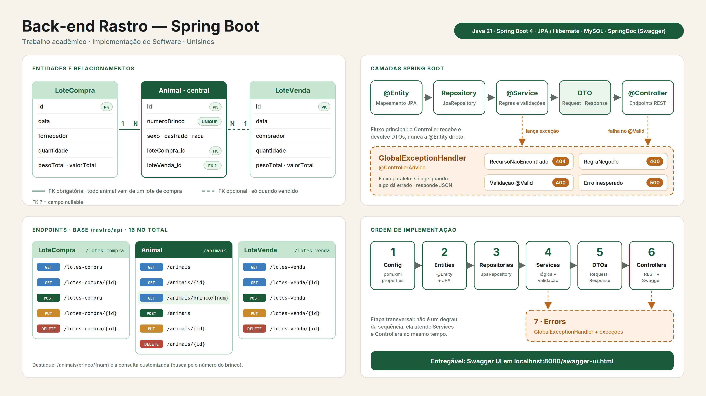

# 🐂 Rastro API


API REST para gestão de pecuária de corte, desenvolvida com Spring Boot. Controla o ciclo de vida do gado, da **compra** à **venda**, passando pela identificação de cada **animal** pelo número do brinco.

> Faz parte do repositório [Rastro](../README.md). O front-end que consome esta API está em [`rastro-front`](../rastro-front/README.md).

> Trabalho acadêmico da disciplina **Implementação de Software** - Unisinos.

---

## 📌 Sobre o Rastro

O **Rastro** é um sistema de gestão de pecuária de corte com rastreamento dos animais. Esta API é o núcleo de dados do sistema: registra os lotes comprados, os animais que entram na propriedade e os lotes vendidos, mantendo a rastreabilidade de cada animal do início ao fim do ciclo.

---

## 🗺️ Visão geral



---

## 🧩 Modelo de dados

| Entidade | Campos | Relacionamento |
|---|---|---|
| **LoteCompra** | `id`, `data`, `fornecedor`, `quantidade` *(calculada)*, `pesoTotal`, `valorTotal` | 1 lote → N animais (entrada) |
| **Animal** *(central)* | `id`, `numeroBrinco` (único), `sexo`, `castrado`, `raca`, `status`, `motivoBaixa`, `dataBaixa`, `loteCompra`, `loteVenda` | pertence a 1 lote de compra (obrigatório) e a 1 lote de venda (quando vendido) |
| **LoteVenda** | `id`, `data`, `comprador`, `quantidade` *(calculada)*, `pesoTotal`, `valorTotal` | 1 lote → N animais (saída) |

**Status do animal** (`StatusAnimal`): `ATIVO` (está na propriedade) · `VENDIDO` (saiu num lote de venda) · `BAIXA` (saiu por morte, descarte ou outro motivo).

O ciclo é: **o lote de compra cria os animais** → o animal fica `ATIVO` → **o lote de venda seleciona os animais** e eles viram `VENDIDO` (ou o animal recebe `BAIXA`). A quantidade dos lotes nunca é digitada: é sempre o número de animais.

---

## 🏗️ Arquitetura

Organizada em camadas, cada uma com uma responsabilidade:

| Camada | Responsabilidade |
|---|---|
| `entity` | Mapeamento das tabelas com JPA/Hibernate |
| `repository` | Acesso ao banco via `JpaRepository` |
| `service` | Regras de negócio e validações |
| `dto` | Objetos de entrada (`RequestDTO`) e saída (`ResponseDTO`) |
| `controller` | Endpoints REST: recebe e devolve DTOs, nunca a entidade diretamente |
| `exception` | Tratamento centralizado de erros com `@ControllerAdvice` |

O tratamento de erros funciona **em paralelo** ao fluxo principal: quando o service lança uma exceção, o `GlobalExceptionHandler` a captura e devolve uma resposta JSON padronizada.

```
src/main/java/br/com/rastro
├── config        → CorsConfig (libera o front), AjusteDadosAntigos (corrige dados antigos ao subir)
├── controller    → AnimalController, LoteCompraController, LoteVendaController
├── dto           → animal/ (inclui BaixaRequestDTO), lotecompra/, lotevenda/
├── entity        → Animal, LoteCompra, LoteVenda, StatusAnimal
├── exception     → GlobalExceptionHandler, ApiErrorResponse,
│                   RecursoNaoEncontradoException, RegraNegocioException
├── repository    → AnimalRepository, LoteCompraRepository, LoteVendaRepository
└── service       → AnimalService, LoteCompraService, LoteVendaService
```

---

## 🔗 Endpoints

Base: `http://localhost:8080/rastro/api`

### Lotes de compra (entrada dos animais)
| Método | Rota | Descrição |
|---|---|---|
| `GET` | `/lotes-compra` | Lista os lotes, com quantos animais estão ativos, vendidos e com baixa |
| `GET` | `/lotes-compra/{id}` | Busca um lote de compra pelo id |
| `POST` | `/lotes-compra` | Cadastra o lote **junto com os animais** (campo `animais`) |
| `PUT` | `/lotes-compra/{id}` | Atualiza só o cabeçalho (data, fornecedor, peso, valor) |
| `DELETE` | `/lotes-compra/{id}` | Exclui o lote e seus animais (bloqueado se algum foi vendido ou teve baixa) |
| `GET` | `/lotes-compra/{id}/animais` | Lista os animais do lote |
| `POST` | `/lotes-compra/{id}/animais` | Adiciona um animal esquecido no cadastro |
| `DELETE` | `/lotes-compra/{id}/animais/{animalId}` | Remove um animal lançado por engano (só `ATIVO`) |

### Animais (consulta, edição e baixa)
| Método | Rota | Descrição |
|---|---|---|
| `GET` | `/animais` | Lista todos os animais |
| `GET` | `/animais/{id}` | Busca um animal pelo id |
| `GET` | `/animais/brinco/{numero}` | Busca um animal pelo número do brinco |
| `PUT` | `/animais/{id}` | Corrige brinco, sexo, castrado e raça (não muda lote nem status) |
| `PATCH` | `/animais/{id}/baixa` | Dá baixa no animal (`MORTE`, `DESCARTE` ou `OUTRO`) |

### Lotes de venda (saída dos animais)
| Método | Rota | Descrição |
|---|---|---|
| `GET` | `/lotes-venda` | Lista os lotes de venda, com os ids dos animais vendidos |
| `GET` | `/lotes-venda/{id}` | Busca um lote de venda pelo id |
| `POST` | `/lotes-venda` | Cadastra a venda **selecionando os animais** (campo `animaisIds`) |
| `PUT` | `/lotes-venda/{id}` | Atualiza a venda e a lista de animais (quem sai volta a `ATIVO`) |
| `DELETE` | `/lotes-venda/{id}` | Exclui a venda; os animais voltam a `ATIVO` (estorno) |

**18 endpoints no total**, todos documentados e testáveis pelo Swagger UI.

---

## 📏 Regras de negócio

- **O animal entra pelo lote de compra.** O lote é criado junto com seus animais, numa única transação: se um brinco falhar, nada é salvo.
- **A quantidade dos lotes é calculada** pelo número de animais. Não existe mais quantidade digitada.
- O número do brinco é **único** (no banco e dentro do mesmo lote) e deve ser **maior que zero**.
- `sexo` aceita `M` ou `F`; `castrado` aceita `S` ou `N`.
- Peso e valor total dos lotes devem ser **maiores que zero**.
- **Só animais `ATIVO` podem ser vendidos** ou receber baixa.
- Excluir um lote de venda **devolve os animais para `ATIVO`**.
- Um lote de compra **não pode ser excluído** se algum animal dele já foi vendido ou recebeu baixa. Também não pode ficar sem animais (para desfazer a compra, exclui-se o lote).

---

## ⚠️ Tratamento de erros

Todas as falhas retornam um JSON no mesmo formato:

```json
{
  "timestamp": "2026-09-28T14:24:38.3494696",
  "status": 404,
  "message": "Animal com brinco 88 não encontrado",
  "path": "/rastro/api/animais/brinco/88",
  "validationErrors": null
}
```

| Situação | Exceção | Status |
|---|---|---|
| Registro não encontrado | `RecursoNaoEncontradoException` | `404` |
| Regra de negócio violada | `RegraNegocioException` | `400` |
| Campo inválido no corpo da requisição | `MethodArgumentNotValidException` | `400` (com a lista de campos em `validationErrors`) |
| Erro inesperado | `Exception` | `500` |

---

## 🚀 Como rodar

### Pré-requisitos
- Java 25
- MySQL 8
- Maven (opcional: o projeto inclui o Maven Wrapper `mvnw`)

### 1. Criar o banco

```sql
CREATE DATABASE rastro_db
  CHARACTER SET utf8mb4
  COLLATE utf8mb4_unicode_ci;
```

As tabelas são criadas automaticamente pelo Hibernate na primeira execução.

### 2. Configurar a senha do banco

A senha não fica no código: a aplicação lê a variável de ambiente `DB_PASSWORD`.

**No IntelliJ:** Run → Edit Configurations → `RastroApiApplication` → Modify options → Environment variables → `DB_PASSWORD=suaSenha`

**No terminal:**

```bash
# Git Bash / Linux / macOS
export DB_PASSWORD=suaSenha

# PowerShell
$env:DB_PASSWORD="suaSenha"
```

### 3. Executar

```bash
./mvnw spring-boot:run
```

### 4. Acessar o Swagger

👉 **http://localhost:8080/swagger-ui.html**

---

## 🧪 Exemplo de uso: o ciclo de vida de um animal

**1. Registrar a compra com os animais** — `POST /lotes-compra`
```json
{
  "data": "2026-11-20",
  "fornecedor": "Estância Bela Vista",
  "pesoTotal": 1000.00,
  "valorTotal": 11200.00,
  "animais": [
    { "numeroBrinco": 101, "sexo": "M", "castrado": "S", "raca": "Angus" },
    { "numeroBrinco": 102, "sexo": "M", "castrado": "S", "raca": "Angus" },
    { "numeroBrinco": 103, "sexo": "F", "castrado": "N", "raca": "Angus" },
    { "numeroBrinco": 104, "sexo": "M", "castrado": "N", "raca": "Hereford" }
  ]
}
```
Resposta: o lote com `"quantidade": 4` e `"ativos": 4`.

**2. Dar baixa num animal** — `PATCH /animais/3/baixa`
```json
{ "motivo": "MORTE", "data": "2026-11-22" }
```

**3. Registrar a venda selecionando os animais** — `POST /lotes-venda`
```json
{
  "data": "2026-11-23",
  "comprador": "Frigorífico Gravataí",
  "pesoTotal": 1150.00,
  "valorTotal": 16500.00,
  "animaisIds": [1, 2, 4]
}
```
Os três animais passam a `VENDIDO` e a venda fica com `"quantidade": 3`.

**4. Consultar pelo brinco** — `GET /animais/brinco/101`
```json
{
  "id": 1,
  "numeroBrinco": 101,
  "sexo": "M",
  "castrado": "S",
  "raca": "Angus",
  "loteCompraId": 1,
  "loteVendaId": 1,
  "status": "VENDIDO",
  "motivoBaixa": null,
  "dataBaixa": null
}
```

O animal aparece vinculado aos dois lotes, com a rastreabilidade completa da compra à venda.

---

## 🔄 Histórico de mudanças

**23/11/2026 — regra de lotes e status do animal** (junto com a criação do front-end)
- Lote de compra passa a criar os animais; quantidade calculada.
- Animal ganha `status` (`ATIVO` / `VENDIDO` / `BAIXA`), baixa com motivo e edição básica. Saem o `POST` e o `DELETE` de animal.
- Lote de venda passa a ser montado selecionando animais; excluir a venda faz o estorno.
- `CorsConfig` libera o front (`http://localhost:5173`).
- `AjusteDadosAntigos` corrige registros criados antes da regra nova.

**28/09/2026 — primeira versão** · CRUD das 3 entidades, Swagger e tratamento de erros.

---

## 🛠️ Tecnologias

Java 25 · Spring Boot 4.1.1 · Spring Web MVC · Spring Data JPA · Hibernate · Bean Validation · MySQL · Lombok · SpringDoc OpenAPI (Swagger UI) · Maven

---

## 🔭 Melhorias futuras

- ~~**Venda por lote:** o lote de venda recebe a lista de animais vendidos.~~ ✅ Feito em 23/11/2026.
- **Pesagem individual:** entidade `Pesagem` com histórico, separando **peso médio do lote** (estimado) de **peso real** (balança). A primeira pesagem individual substitui a média como peso de entrada; o ganho de peso só é calculado entre pesagens reais.
- **Eventos sanitários** (vacina, vermífugo) registrados por animal.
- **Desfazer baixa.**
- **Integração com o rastreamento GPS** do sistema Rastro.
- **Testes automatizados** com JUnit e MockMvc.
- **Autenticação** para proteger os endpoints.

---

## 📂 Materiais do trabalho

- [Fluxograma do back-end](docs/rastro_fluxograma.png)
- [Apresentação (PDF)](docs/apresentacao.pdf)

---

## 👤 Autor

**Aquiles Ferreira**
Implementação de Software · Unisinos · 2026

---

## 🤝 Como contribuir

Contribuições são bem-vindas! Para colaborar:

1. Faça um **fork** deste repositório.
2. Crie uma branch para a sua alteração: `git checkout -b minha-melhoria`
3. Faça commit das mudanças com uma mensagem clara.
4. Envie para o seu fork e abra um **Pull Request** explicando o que foi feito e por quê.

Encontrou um bug ou tem uma ideia? Abra uma **Issue** para conversarmos. A seção [Melhorias futuras](#-melhorias-futuras) é um bom ponto de partida.

Ao contribuir, você concorda que sua contribuição será licenciada sob a mesma licença do projeto.

---

## 📄 Licença

Este projeto é **open source** e está licenciado sob a **GNU Affero General Public License v3.0 (AGPL-3.0)**.

Você pode usar, estudar, modificar e distribuir este código, desde que:

- mantenha os créditos ao autor original;
- distribua as versões modificadas sob a mesma licença;
- disponibilize o código-fonte de qualquer versão modificada, inclusive quando ela for oferecida como serviço pela internet.

O nome **Rastro** e sua identidade visual não estão incluídos nesta licença.

© 2026 **Aquiles Ferreira**. Consulte o arquivo [LICENSE](LICENSE) para o texto completo.